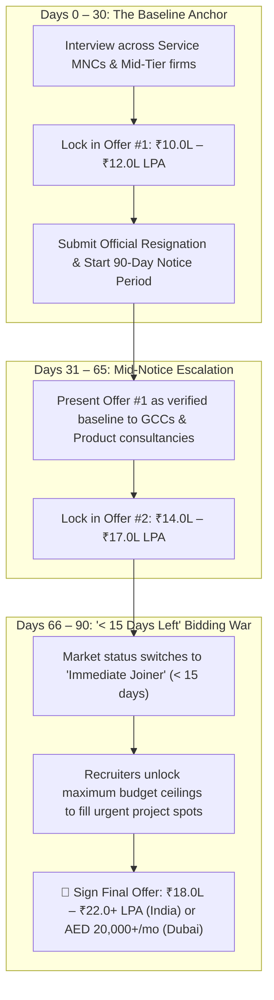
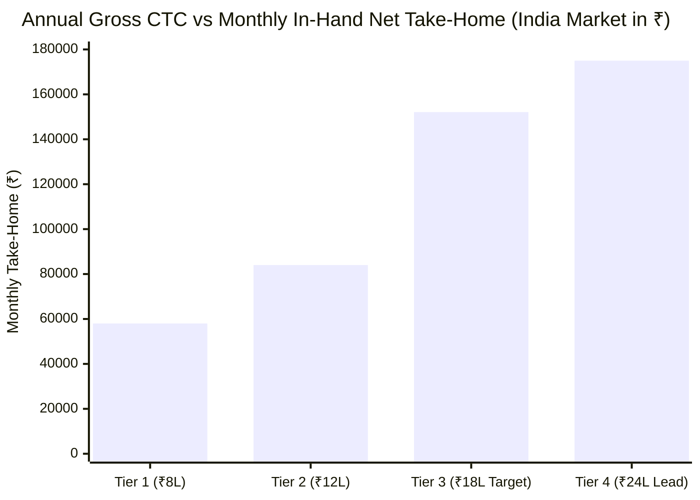
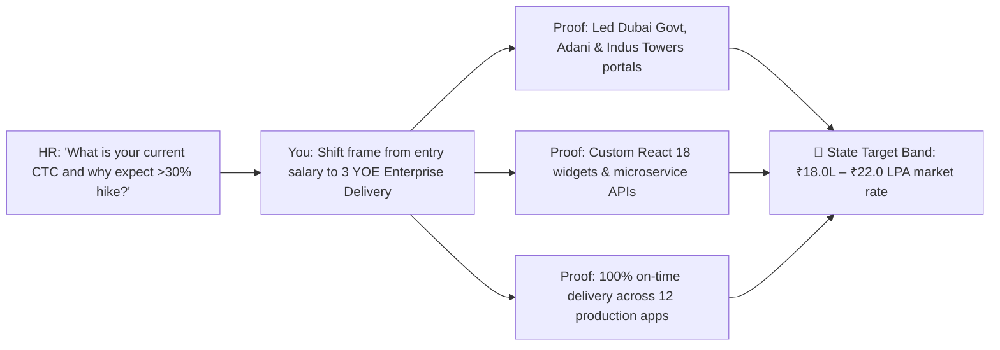

# 💰 Senior Compensation Benchmarks & Salary Negotiation Playbook

> **Tactical Negotiation Framework, Scripts, and Compensation Data for 3+ YOE Software Engineers**  
> *Target Salary: ₹16.0 – ₹22.0+ LPA (India) / AED 18,000 – AED 25,000 / month (Dubai Tax-Free)*

---

## 🪜 1. Visual 3-Offer Notice Period Escalation Ladder

---

## 💵 2. Visual Compensation Tiers & Monthly Net Take-Home (India)

### Key Milestone:
Your targeted monthly net inflow of **₹1,52,100 / month** matches an annual CTC of **₹18.0 LPA – ₹20.0 LPA** under standard Indian tax regimes.

---

## 🎯 3. Visual Negotiation Dialogue Strategy

---

## 🌍 4. Visual Comparison: India vs. Dubai / UAE Direct Route

```mermaid
flowchart TD
    subgraph INDIA["India (Bengaluru / Chennai / Hyderabad)"]
        IN_GROSS["Gross CTC: ₹18.0L – ₹22.0L LPA"]
        IN_TAX["Income Tax: ~20% – 25% under New Tax Regime"]
        IN_NET["Net In-Hand: ₹1,20,000 – ₹1,52,100 / month"]
        IN_NOTICE["Standard 90-day notice period negotiations required"]
        IN_GROSS --> IN_TAX --> IN_NET --> IN_NOTICE
    end

    subgraph DUBAI["Dubai / UAE Enterprise Market"]
        DXB_GROSS["Monthly Salary: AED 18,000 – AED 25,000 / month"]
        DXB_TAX["Income Tax: 0% (Completely Tax-Free)"]
        DXB_NET["Net In-Hand: ₹4,50,000 – ₹6,20,000 INR / month"]
        DXB_NO_SLIP["Zero questions about past Indian salary slips"]
        DXB_GROSS --> DXB_TAX --> DXB_NET --> DXB_NO_SLIP
    end
```

