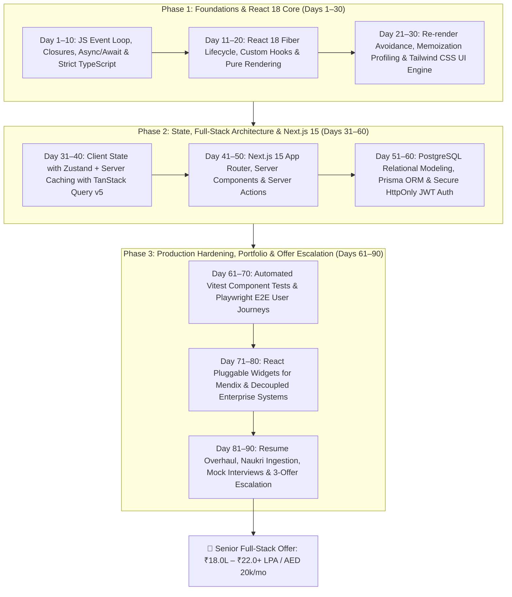

# 🗺️ 90-Day Visual Career & Technical Transformation Roadmap
> **From Enterprise Low-Code / Mendix Developer to Senior Full-Stack React Engineer (₹18L–₹22L+ LPA)**

---

## 🧭 Visual Master Flowchart

---

## 📅 Visual Sprint Progression (12-Week Roadmap)

```mermaid
flowchart LR
    W01["W1: JS Runtime & Event Loop"] --> W02["W2: TypeScript Strict Mastery"]
    W02 --> W03["W3: React 18 Hooks & Fiber"]
    W03 --> W04["W4: Custom Hooks Architecture"]
    W04 --> W05["W5: Zustand Client State"]
    W05 --> W06["W6: TanStack Query v5 Server State"]
    W06 --> W07["W7: Next.js 15 App Router"]
    W07 --> W08["W8: PostgreSQL, Prisma & JWT Auth"]
    W08 --> W09["W9: React Pluggable Widgets for Mendix"]
    W09 --> W10["W10: Playwright E2E Testing"]
    W10 --> W11["W11: System Design & Naukri Sprints"]
    W11 --> W12["W12: 3-Offer Bidding & Negotiation"]
```

---

## 📆 Phase-by-Phase Deep Dive & Milestones

### 🟢 PHASE 1: Days 1 to 30 — JavaScript Internals, TypeScript & React 18
*Goal: Bridge the gap between visual logic and low-level JavaScript execution.*

| Week | Daily Targets | Core Concepts to Master | Practical Milestone Project |
| :---: | :--- | :--- | :--- |
| **Week 1 (Days 1–7)** | • Microtask vs Macrotask queue • Execution Context & Call Stack • Closures & Lexical Scope • Promise chaining & async/await error boundaries | • Event Loop internals • Debouncing and throttling algorithms • Array methods under the hood (`reduce`, `map`, `filter`) | Build a standalone **Async Task Scheduler** in pure TypeScript with priority queues. |
| **Week 2 (Days 8–14)** | • Generics (`<T, K>`) • Discriminated Unions for UI state • Utility Types (`Pick`, `Omit`, `Partial`, `Record`) • Type Narrowing & Type Guards | • TypeScript 5+ Strict Mode • Typing React Props & Events • Typing custom hook return tuples | Refactor a complex form using **Discriminated Unions** for `idle \| submitting \| success \| error`. |
| **Week 3 (Days 15–21)** | • Virtual DOM & Fiber reconciliation • Render Phase vs Commit Phase • `useState` & `useReducer` state machines • `useRef` for persistent non-rendering values | • Reconciliation algorithm & Keys in lists • Avoiding state mutation traps • Eliminating cascading re-renders | Build an interactive **Multi-Step Stepper Slider Form** with pure functional components. |
| **Week 4 (Days 22–30)** | • Reusable Custom Hooks library • `useCallback` & `useMemo` profiling • Component Composition (`children` prop) • Tailwind CSS 4 layout engine | • Custom Hook mental model • React DevTools Profiler • Responsive mobile-first design | Build a reusable custom hooks package: `useDebounce`, `useLocalStorage`, `useClickOutside`. |

---

### 🟡 PHASE 2: Days 31 to 60 — State Architecture, Full-Stack Next.js 15 & PostgreSQL
*Goal: Build production-grade decoupled architectures and full-stack applications.*

| Week | Daily Targets | Core Concepts to Master | Practical Milestone Project |
| :---: | :--- | :--- | :--- |
| **Week 5 (Days 31–37)** | • Zustand store design • Slice pattern for modularity • Persist middleware & hydration • Invoking actions outside React tree | • Zero-boilerplate client state • Selective re-render subscriptions • Comparison with Redux Toolkit | Build a global financial portfolio state store using **Zustand** with local persistence. |
| **Week 6 (Days 38–44)** | • TanStack Query v5 fundamentals • Query Keys and invalidation • Stale-While-Revalidate caching • Optimistic UI mutations & rollbacks | • Server-state vs Client-state separation • Background refetching & window focus • Infinite queries & pagination | Build a live data grid with **optimistic updates** and automated server rollback on network error. |
| **Week 7 (Days 45–51)** | • Next.js 15 App Router • React Server Components (RSC) vs `'use client'` • Server Actions for data mutation • Route Handlers & dynamic routes | • Streaming with Suspense • SEO metadata and dynamic OG images • Zero-bundle-size server components | Build an authenticated enterprise dashboard using **Next.js 15 Server Components**. |
| **Week 8 (Days 52–60)** | • PostgreSQL schema design • Prisma ORM / Drizzle ORM migrations • JWT in `HttpOnly` `SameSite=Strict` cookies • Role-Based Access Control (RBAC) guards | • Relational joins, foreign keys, indexing • XSS & CSRF defense architecture • Protected API route middleware | Deploy a full-stack **Authentication & User Management Engine** with JWT cookies and PostgreSQL. |

---

### 🟣 PHASE 3: Days 61 to 90 — Testing, Mendix-React Hybrid Systems & Offer Negotiation
*Goal: Prove senior delivery capability, pass interviews with high scores, and command top compensation.*

| Week | Daily Targets | Core Concepts to Master | Practical Milestone Project |
| :---: | :--- | :--- | :--- |
| **Week 9 (Days 61–67)** | • Mendix React Pluggable Widgets API • Bridging Mendix Studio Pro with React 18 • Consuming Headless Mendix REST & OData APIs • Offline-first mobile nanoflows | • Low-Code + Pro-Code hybrid systems • Model-as-Code & custom UI components • Enterprise ERP integration patterns | Author a custom **React 18 Pluggable Widget** for Mendix and publish it as an enterprise module. |
| **Week 10 (Days 68–74)** | • Component testing with Vitest & RTL • User interaction testing (`userEvent`) • End-to-end journey tests with Playwright • Mobile viewport emulation & visual regression | • Testing behavior, not implementation • Mock Service Worker (MSW) for API mocks • Automated CI/CD test execution | Create an automated **Playwright E2E Test Suite** covering 50+ user flows on mobile & desktop. |
| **Week 11 (Days 75–81)** | • Frontend System Design patterns • Virtualized lists for 100k+ rows (`@tanstack/react-virtual`) • Web Vitals (LCP, FID, CLS) optimization • Top 50 technical interview questions rehearsal | • High-throughput UI rendering • Code splitting with `React.lazy` • Architectural trade-off communication | Conduct 3 timed mock technical interviews covering React Fiber, state engines, and system design. |
| **Week 12 (Days 82–90)** | • Naukri profile optimization with Chennai keywords • Executing the 3-Offer Notice Period Escalator • Breaking the 30% hike ceiling script • Final offer selection & onboarding prep | • Notice period leverage strategy • Direct UAE / Dubai application routes • Cross-offer bidding war execution | **Sign Offer Letter at ₹18.0L – ₹22.0+ LPA (India) or AED 20,000+/mo (Dubai).** |

---

## 🏆 Definition of Done (Checklist to Complete Before Applying)
- [ ] Live GitHub repositories (`react-fullstack-mastery` & `career-development`) showcasing production code.
- [ ] At least one full-stack project running live (e.g. Next.js 15 + PostgreSQL + Tailwind).
- [ ] At least one custom React Pluggable Widget built for Mendix Studio Pro.
- [ ] Automated Playwright test suite passing with zero failures.
- [ ] Naukri profile updated with senior keywords and 30-day notice visibility.
