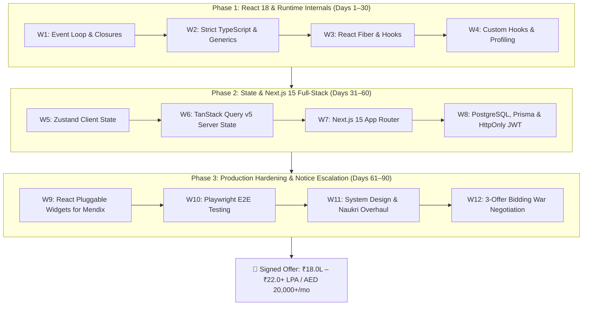

# 🚀 Career Development Master Repository
> **Private Career Transformation Blueprint & 90-Day Execution System for Varun S T**  
> *Target Title: Senior Full-Stack Lead / Enterprise Decoupled Architect*  
> *Target CTC: ₹18.0L – ₹22.0+ LPA (India) / AED 18k – 25k/mo Tax-Free (Dubai)*

---

## 🔒 Confidential & Private Repository
This repository contains the verified market intelligence, live job scraping research from Naukri Chennai, career positioning guides, and interactive visual roadmaps to accelerate the transition from 3 Years Mendix Experience into high-paying Senior Full-Stack React engineering roles.

---

## 🗺️ Master Directory Structure

```text
career-development/
├── 01-market-research/
│   └── naukri-job-market-chennai.md         # Live crawling & skill demand analysis across Chennai MNCs/GCCs
├── 02-career-strategy/
│   └── mendix-to-react-transition-guide.md  # How to frame 3 YOE, resume before/after, top 5 interview Q&A
├── 03-salary-and-negotiation/
│   └── compensation-benchmarks-and-scripts.md # Breaking 30% hike trap, 3-offer notice escalator, Dubai tax-free route
└── 04-visual-roadmap/
    ├── VISUAL_90_DAY_ROADMAP.md             # Markdown visual roadmap with Mermaid flowcharts & sprint targets
    └── interactive-roadmap.html             # Interactive HTML web application with progress bar & persistent checklist
```

---

## 🧭 Visual 90-Day Sprint Overview



---

## 📊 Quick Links & Resources
- 🌐 **Interactive Roadmap:** Open [`04-visual-roadmap/interactive-roadmap.html`](04-visual-roadmap/interactive-roadmap.html) in your browser to interactively check off daily milestones and track progress in real-time.
- 📋 **Live Job Scraping:** Read [`01-market-research/naukri-job-market-chennai.md`](01-market-research/naukri-job-market-chennai.md) for actual job descriptions from Deloitte, Infosys, Cognizant, Apex Group, and Shreemax Global.
- 🗣️ **Interview & Resume Guide:** Read [`02-career-strategy/mendix-to-react-transition-guide.md`](02-career-strategy/mendix-to-react-transition-guide.md) to reframe your experience from "low-code" to "enterprise full-stack lead".
- 💰 **Salary Negotiation:** Read [`03-salary-and-negotiation/compensation-benchmarks-and-scripts.md`](03-salary-and-negotiation/compensation-benchmarks-and-scripts.md) for the 3-offer notice period ladder script.

---
*Author: Varun S T • Private & Confidential*
